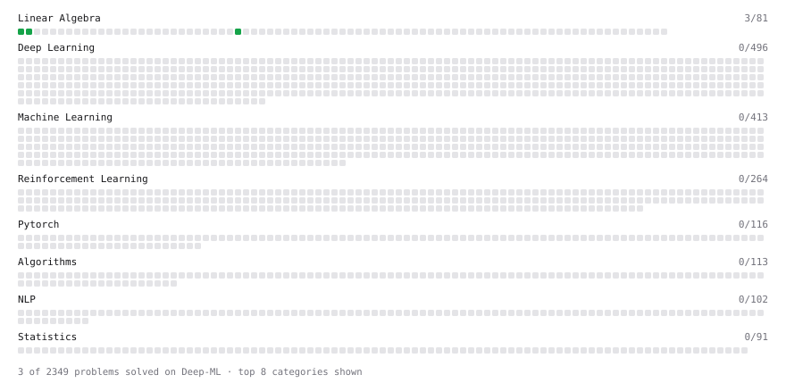

# Deep-ML

My machine learning practice from [Deep-ML](https://www.deep-ml.com). Every solution here was written by hand.

**5** solved · 3 problems · 0 labs · 2 math

[**Browse the interactive portfolio**](https://ShaimaaElromh.github.io/deep-ml/) to replay this filling in over time.

## Problems

| | Difficulty | Solved | |
| --- | --- | --- | --- |
| [Dot Product Calculator](https://www.deep-ml.com/problems/83) | easy | 2026-10-24 | [solution](problems/0083-dot-product-calculator) |
| [Matrix-Vector Dot Product](https://www.deep-ml.com/problems/1) | easy | 2026-10-25 | [solution](problems/0001-matrix-vector-dot-product) |
| [Transpose of a Matrix](https://www.deep-ml.com/problems/2) | easy | 2026-10-25 | [solution](problems/0002-transpose-of-a-matrix) |

## Math

| | Difficulty | Solved | |
| --- | --- | --- | --- |
| [Descriptive Statistics](https://www.deep-ml.com/math-problems/18) | easy | 2026-11-12 | [solution](math/0018-descriptive-statistics) |
| [ML Workflow Basics](https://www.deep-ml.com/math-problems/30) | easy | 2026-11-19 | [solution](math/0030-ml-workflow-basics) |

---

_This file is regenerated by Deep-ML on every push._
